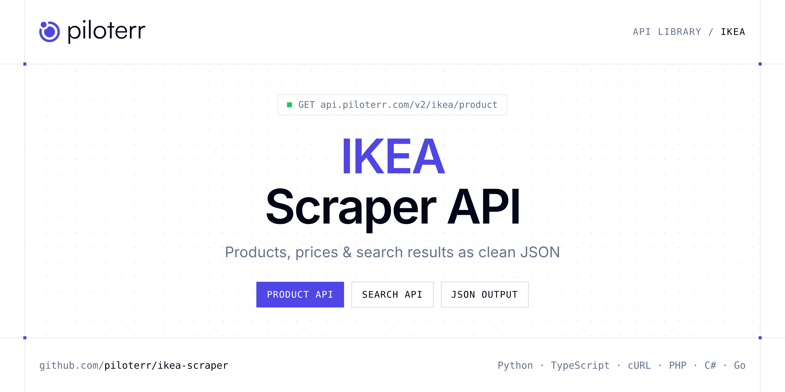

<p align="center">
  <a href="https://www.piloterr.com"></a>
</p>

# IKEA Scraper API

[](https://discord.gg/CFj3ph8aHU) [](https://app.piloterr.com) [](https://app.piloterr.com/openapi) [](LICENSE)

The **Piloterr IKEA Scraper API** lets you extract public data from IKEA as **clean, structured JSON** — no proxies, headless browsers or HTML parsing to maintain. Endpoints available in production:

- **IKEA Product API** — Extract full IKEA product details from a product URL, including price, gallery, variants, dimensions, and breadcrumb.
- **IKEA Search API** — Search IKEA products from a search URL and retrieve prices, ratings, dimensions, images, and pagination.

Use it for price monitoring, assortment tracking, competitor analysis, product research or catalog enrichment.

| Endpoint | Path | Credits | What you get |
|---|---|---|---|
| [IKEA Product API](#ikea-product-api) | `/v2/ikea/product` | 1 | Extract full IKEA product details from a product URL, including price, gallery, variants, dimensions, and breadcrumb. |
| [IKEA Search API](#ikea-search-api) | `/v2/ikea/search` | 1 | Search IKEA products from a search URL and retrieve prices, ratings, dimensions, images, and pagination. |

## Table of contents

- [How it works](#how-it-works)
- [IKEA Product API](#ikea-product-api)
- [IKEA Search API](#ikea-search-api)
- [Code examples in other languages](#code-examples-in-other-languages)
- [Practical use cases](#practical-use-cases)
- [Why Piloterr?](#why-piloterr)
- [FAQ](#faq)
- [Related scrapers](#related-scrapers)
- [Support](#support)

## How it works

1. **Create a free Piloterr account** and copy your API key from the [dashboard](https://app.piloterr.com).
2. **Send a `GET` (or `POST`) request** to `https://api.piloterr.com/v2/...` with the header `x-api-key: YOUR_API_KEY`.
3. **Receive structured JSON** — Piloterr handles rendering, proxies, retries and parsing.

```bash
export PILOTERR_API_KEY="your-api-key"
pip install requests        # Python
# TypeScript: Node.js 18+ (native fetch), run with `npx tsx file.ts`
```

> Every endpoint accepts both `GET` (query string) and `POST` (JSON body with the same fields).

## IKEA Product API

Extract full IKEA product details from a product URL, including price, gallery, variants, dimensions, and breadcrumb.

`GET | POST https://api.piloterr.com/v2/ikea/product` · **1 credit per request** · [Full reference](https://app.piloterr.com/openapi)

### Request parameters

| Parameter | Type | Required | Description |
|---|---|---|---|
| `query` | string | ✅ | Full IKEA product page URL. |

### Python example

```python
import json
import os
import requests

response = requests.get(
    "https://api.piloterr.com/v2/ikea/product",
    headers={"x-api-key": os.environ["PILOTERR_API_KEY"]},
    params={
        "query": "https://www.ikea.com/fr/fr/p/gladhoejden-bureau-assis-debout-blanc-30493939/",
    },
    timeout=60,
)
response.raise_for_status()
data = response.json()

print(json.dumps(data, indent=2, ensure_ascii=False)[:2000])
```

### TypeScript example

```typescript
type IkeaProduct = {
  id?: string;
  url?: string;
  image?: string;
  price?: string;
  title?: string;
  images?: string[];
  rating?: number;
  measure?: string;
  category?: string;
  currency?: string;
  variants?: {
    id?: string;
    url?: string;
    name?: string;
    image?: string;
  }[];
  breadcrumb?: {
    url?: string;
    name?: string;
  }[];
  dimensions?: {
    depth?: string;
    width?: string;
    height?: string;
  };
  description?: string;
  price_amount?: number;
  reviews_count?: number;
};

const params = new URLSearchParams({
  "query": "https://www.ikea.com/fr/fr/p/gladhoejden-bureau-assis-debout-blanc-30493939/",
});

const response = await fetch(`https://api.piloterr.com/v2/ikea/product?${params}`, {
  headers: { "x-api-key": process.env.PILOTERR_API_KEY! },
});
if (!response.ok) throw new Error(`Piloterr error ${response.status}: ${await response.text()}`);

const data = (await response.json()) as IkeaProduct;

console.log(JSON.stringify(data, null, 2).slice(0, 2000));
```

<details>
<summary><b>POST variant</b></summary>

```http
POST https://api.piloterr.com/v2/ikea/product
x-api-key: YOUR_API_KEY
Content-Type: application/json

{"query": "https://www.ikea.com/fr/fr/p/gladhoejden-bureau-assis-debout-blanc-30493939/"}
```
</details>

### Output example

Example response from the API reference, abridged — real values depend on the page you scrape.

```json
{
  "id": "30493939",
  "url": "https://www.ikea.com/fr/fr/p/gladhoejden-bureau-assis-debout-blanc-30493939/",
  "image": "https://www.ikea.com/fr/fr/images/products/gladhoejden-bureau-assis-debout-blanc__1159429_pe888476_s5.jpg",
  "price": "149 €",
  "title": "GLADHÖJDEN Bureau assis/debout, blanc, 100x60 cm",
  "images": [
    "https://www.ikea.com/fr/fr/images/products/gladhoejden-bureau-assis-debout-blanc__1159429_pe888476_s5.jpg",
    "https://www.ikea.com/fr/fr/images/products/gladhoejden-bureau-assis-debout-blanc__1159428_pe888477_s5.jpg"
  ],
  "rating": 4.1,
  "measure": "100x60cm",
  "category": "Bureaux pour la maison",
  "currency": "€",
  "variants": [
    {
      "id": "30493939",
      "url": "https://www.ikea.com/fr/fr/p/gladhoejden-bureau-assis-debout-blanc-30493939/",
      "name": "Blanc",
      "image": "https://www.ikea.com/fr/fr/images/products/gladhoejden-bureau-assis-debout-blanc__1159429_pe888476_s5.jpg"
    },
    {
      "id": "20541610",
      "url": "https://www.ikea.com/fr/fr/p/gladhoejden-bureau-assis-debout-gris-clair-anthracite-20541610/",
      "name": "Gris clair/anthracite",
      "image": "https://www.ikea.com/fr/fr/images/products/gladhoejden-bureau-assis-debout-gris-clair-anthracite__1159426_pe888475_s5.jpg"
    }
  ],
  "breadcrumb": [
    {
      "url": "https://www.ikea.com/fr/fr/cat/produits-products/",
      "name": "Produits"
    },
    {
      "url": "https://www.ikea.com/fr/fr/cat/bureaux-chaises-de-bureau-fu004/",
      "name": "Bureaux & chaises de bureau"
    }
  ],
  "dimensions": {
    "depth": "100 cm",
    "width": "10 kg",
    "height": "60 cm"
  },
  "description": "Vous travaillez depuis la maison ? Ce bureau assis/debout permet de passer la journée bien installé. Grâce un vérin à gaz, le bureau mont…",
  "price_amount": 149,
  "reviews_count": 9
}
```

### Response fields

| Field | Type | Description |
|---|---|---|
| `id` | string |  |
| `url` | string |  |
| `image` | string |  |
| `price` | string |  |
| `title` | string |  |
| `images` | string[] |  |
| `rating` | number |  |
| `measure` | string |  |
| `category` | string |  |
| `currency` | string |  |
| `variants[]` | object[] |  |
| `variants[].id` | string |  |
| `variants[].url` | string |  |
| `variants[].name` | string |  |
| `variants[].image` | string |  |
| `breadcrumb[]` | object[] |  |
| `breadcrumb[].url` | string |  |
| `breadcrumb[].name` | string |  |
| `dimensions` | object |  |
| `dimensions.depth` | string |  |
| `dimensions.width` | string |  |
| `dimensions.height` | string |  |
| `description` | string |  |
| `price_amount` | integer |  |
| `reviews_count` | integer |  |

## IKEA Search API

Search IKEA products from a search URL and retrieve prices, ratings, dimensions, images, and pagination.

`GET | POST https://api.piloterr.com/v2/ikea/search` · **1 credit per request** · [Full reference](https://app.piloterr.com/openapi)

### Request parameters

| Parameter | Type | Required | Description |
|---|---|---|---|
| `query` | string | ✅ | Full IKEA search URL. |

### Python example

```python
import json
import os
import requests

response = requests.get(
    "https://api.piloterr.com/v2/ikea/search",
    headers={"x-api-key": os.environ["PILOTERR_API_KEY"]},
    params={
        "query": "https://www.ikea.com/fr/fr/search/?q=meuble",
    },
    timeout=60,
)
response.raise_for_status()
data = response.json()

print(json.dumps(data, indent=2, ensure_ascii=False)[:2000])
```

### TypeScript example

```typescript
type IkeaSearch = {
  results?: {
    id?: string;
    url?: string;
    image?: string;
    price?: string;
    title?: string;
    rating?: number;
    measure?: string;
    currency?: string;
    subtitle?: string;
    price_amount?: number;
    reviews_count?: number;
    online_sellable?: boolean;
  }[];
  pagination?: {
    next?: number;
    current?: number;
    next_url?: string;
    per_page?: number;
    total_count?: number;
    total_pages?: number;
    has_next_page?: boolean;
  };
};

const params = new URLSearchParams({
  "query": "https://www.ikea.com/fr/fr/search/?q=meuble",
});

const response = await fetch(`https://api.piloterr.com/v2/ikea/search?${params}`, {
  headers: { "x-api-key": process.env.PILOTERR_API_KEY! },
});
if (!response.ok) throw new Error(`Piloterr error ${response.status}: ${await response.text()}`);

const data = (await response.json()) as IkeaSearch;

console.log(JSON.stringify(data, null, 2).slice(0, 2000));
```

<details>
<summary><b>POST variant</b></summary>

```http
POST https://api.piloterr.com/v2/ikea/search
x-api-key: YOUR_API_KEY
Content-Type: application/json

{"query": "https://www.ikea.com/fr/fr/search/?q=meuble"}
```
</details>

### Output example

Example response from the API reference, abridged — real values depend on the page you scrape.

```json
{
  "results": [
    {
      "id": "60282186",
      "url": "https://www.ikea.com/fr/fr/p/lack-etagere-blanc-60282186/",
      "image": "https://www.ikea.com/fr/fr/images/products/lack-etagere-blanc__0246565_pe385541_s5.jpg",
      "price": "69,99€",
      "title": "LACK",
      "rating": 4.8,
      "measure": "30x190 cm",
      "currency": "EUR",
      "subtitle": "Étagère",
      "price_amount": 69.99,
      "reviews_count": 327,
      "online_sellable": true
    },
    {
      "id": "20574587",
      "url": "https://www.ikea.com/fr/fr/p/eket-element-2-portes-et-1-tablette-brun-motif-noyer-20574587/",
      "image": "https://www.ikea.com/fr/fr/images/products/eket-element-2-portes-et-1-tablette-brun-motif-noyer__1373669_pe960035_s5.jpg",
      "price": "105€",
      "title": "EKET",
      "rating": 3.3,
      "measure": "70x35x70 cm",
      "currency": "EUR",
      "subtitle": "Élément 2 portes et 1 tablette",
      "price_amount": 105,
      "reviews_count": 184,
      "online_sellable": true
    }
  ],
  "pagination": {
    "next": 2,
    "current": 1,
    "next_url": "https://www.ikea.com/fr/fr/search/?q=meuble&page=2",
    "per_page": 24,
    "total_count": 766,
    "total_pages": 32,
    "has_next_page": true
  }
}
```

### Response fields

| Field | Type | Description |
|---|---|---|
| `results[]` | object[] |  |
| `results[].id` | string |  |
| `results[].url` | string |  |
| `results[].image` | string |  |
| `results[].price` | string |  |
| `results[].title` | string |  |
| `results[].rating` | number |  |
| `results[].measure` | string |  |
| `results[].currency` | string |  |
| `results[].subtitle` | string |  |
| `results[].price_amount` | number |  |
| `results[].reviews_count` | integer |  |
| `results[].online_sellable` | boolean |  |
| `pagination` | object |  |
| `pagination.next` | integer |  |
| `pagination.current` | integer |  |
| `pagination.next_url` | string |  |
| `pagination.per_page` | integer |  |
| `pagination.total_count` | integer |  |
| `pagination.total_pages` | integer |  |
| `pagination.has_next_page` | boolean |  |

## Code examples in other languages

Ready-to-run examples live in the [`examples/`](examples) folder. Each one reads your key from the `PILOTERR_API_KEY` environment variable.

| Language | Product | Search |
|---|---|---|
| cURL (Bash) | [`product`](examples/curl/product.sh) | [`search`](examples/curl/search.sh) |
| PHP | [`product`](examples/php/product.php) | [`search`](examples/php/search.php) |
| C# | [`product`](examples/csharp/Product.cs) | [`search`](examples/csharp/Search.cs) |
| Go | [`product`](examples/go/product.go) | [`search`](examples/go/search.go) |
| Java | [`product`](examples/java/ProductExample.java) | [`search`](examples/java/SearchExample.java) |
| Ruby | [`product`](examples/ruby/product.rb) | [`search`](examples/ruby/search.rb) |
| Node.js | [`product`](examples/nodejs/product.mjs) | [`search`](examples/nodejs/search.mjs) |

## Practical use cases

- **Price monitoring** — Track prices, promotions and availability over time to react to competitors.
- **Assortment & catalog tracking** — Follow new products, delisted items and category changes.
- **Competitor analysis** — Benchmark ranges, brands and positioning across retailers.
- **Product research** — Spot best-sellers and trends from search results.
- **Catalog enrichment** — Pull titles, images and attributes into your PIM or marketplace listings.

## Why Piloterr?

- **No infrastructure** — no proxies, headless browsers or CAPTCHA solving to run yourself.
- **Structured JSON** — stable, documented fields instead of brittle HTML selectors.
- **Pay per request** — transparent credit cost per endpoint, failed requests are retried for you.
- **One API key, hundreds of sources** — IKEA plus many other e-commerce, search and company data endpoints in the [Piloterr library](https://www.piloterr.com/library).
- **Any language** — plain HTTPS + JSON, with examples for Python, TypeScript, cURL, PHP, C#, Go, Java, Ruby and Node.js.

## FAQ

### Is it legal to scrape IKEA?

Collecting publicly available data is generally allowed in many jurisdictions, but rules depend on your country, the data you collect and how you use it. Avoid personal data unless you have a lawful basis, respect the website's terms where they apply, and get legal advice for your specific use case. This is not legal advice.

### Do I need proxies or a headless browser?

No. Piloterr handles rendering, proxy rotation and retries on its side. You only send an HTTPS request with your `x-api-key` header and receive JSON.

### How much does a request cost?

Credits per call: `/v2/ikea/product` **1**, `/v2/ikea/search` **1**. See the [Piloterr website](https://www.piloterr.com) for plans.

### What data does the IKEA API return?

Each endpoint returns structured JSON: **IKEA Product** — `id`, `url`, `image`, `price`, `title`, `images`; **IKEA Search** — `results[]`, `results[].id`, `results[].url`, `results[].image`, `results[].price`, `results[].title`.

### Which languages are supported?

Any language that can make an HTTP request. This README shows Python and TypeScript; the [`examples/`](examples) folder contains cURL, PHP, C#, Go, Java, Ruby and Node.js.

## Related scrapers

- [About You Scraper API](https://github.com/piloterr/aboutyou-scraper)
- [Action Scraper API](https://github.com/piloterr/action-scraper)
- [Aldi Scraper API](https://github.com/piloterr/aldi-scraper)
- [Alibaba Scraper API](https://github.com/piloterr/alibaba-scraper)
- [AliExpress Scraper API](https://github.com/piloterr/aliexpress-scraper)
- [Allegro Scraper API](https://github.com/piloterr/allegro-scraper)
- [All Piloterr scrapers on GitHub](https://github.com/piloterr)

## Support

- 💬 Join the [Piloterr Discord](https://discord.gg/CFj3ph8aHU) to ask questions and share what you build.
- 📚 Browse the [API reference (OpenAPI)](https://app.piloterr.com/openapi) and the [Piloterr library](https://www.piloterr.com/library).
- 🔑 [Get your API key](https://app.piloterr.com).

---

<p align="center">
  <a href="https://www.piloterr.com">
    <picture>
      <source media="(prefers-color-scheme: dark)" srcset="images/logo-dark.svg">
      
    </picture>
  </a>
  <br>
  <sub>Built by <a href="https://www.piloterr.com">Piloterr</a> — web scraping APIs for e-commerce, search, real estate and more, one API key.</sub>
</p>

<sub>IKEA is a trademark of its respective owner. This repository is not affiliated with or endorsed by IKEA. Examples are released under the MIT license.</sub>
